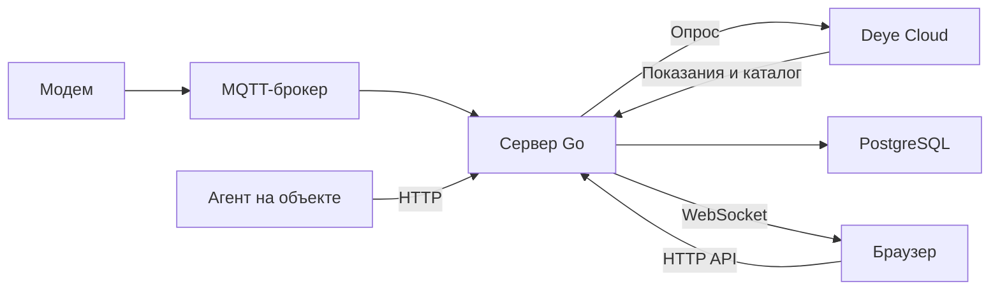

# Архитектура приложения

В браузере работает CRM на React и TypeScript. Сервер на Go принимает HTTP-запросы, обрабатывает данные оборудования и отправляет обновления открытым экранам. PostgreSQL хранит состояние и историю. Redis Pub/Sub передаёт события между процессами, когда он настроен.

**Путь одного показания.** Для зарегистрированного модема сервер разбирает пакет на секции оборудования. Сервис телеметрии записывает историю, обновляет карточку устройства и публикует событие для браузера. При отдельном измерении с текстовым кодом устройства тот же сервис находит устройство непосредственно по этому коду. Правила ошибок и потери связи общие для источников. [Обработка измерений](../services/telemetry.go)

## Где менять код

| Задача | Точка входа |
|---|---|
| Найти HTTP-маршрут и проверку доступа | [Маршруты](../server/server.go), [авторизация и роли](../middleware/auth.go) |
| Изменить форму запроса или ответа | [HTTP-обработчики](../handlers/api), [типы данных](../types) |
| Разобраться в опросе облака | [Сборщик](../services/vendor_collector.go), [интеграция Deye](../services/deye.go), [клиент API производителя](../pkg/deye) |
| Изменить чтение или хранение данных | [Репозитории PostgreSQL](../db/repositories), [миграции](../db/migrations). SQL для заявок и отчётов также находится в обработчиках CRM. |
| Проверить передачу событий | [Рассылка](../pkg/hub), [WebSocket](../handlers/ws) |
| Найти экран или форму | [Исходники интерфейса](../web/src), [маршруты интерфейса](../web/src/main.tsx) |
| Найти программу для установки на объекте | [Python-агент](../agent), [обработчики запросов агента](../handlers/agent) |
| Изучить запуск фоновых задач и служебных команд | [Создание сервисов](../server/services.go), [утилиты командной строки](../cmd) |

## Что выполняется в фоне

- Проверка времени последнего сообщения определяет, что оборудование потеряло связь. Для облачных устройств есть отдельный тайм-аут.
- При `MQTT_ENABLED=true` сервер подписывается на топик модемов. В шаблоне конфигурации это `inverter/+/data`, где средний сегмент — серийный номер.
- При `DEYE_ENABLED=true` запускаются сборщик показаний и синхронизация каталога. Каталог хранит перечень станций, а сборщик пополняет историю измерений импортированного оборудования.
- При `DEMO_MODE=true` генератор создаёт тестовые измерения для подходящих модемов. Источники и смысл результатов подробно разобраны в [бизнес-логике](BUSINESS_LOGIC.md).
