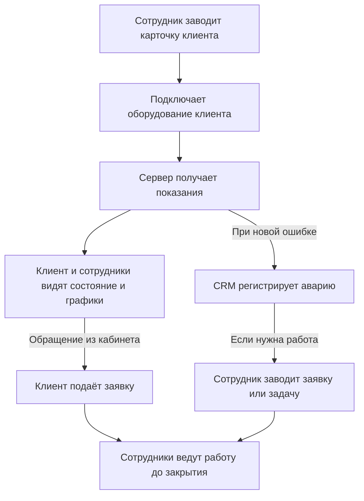
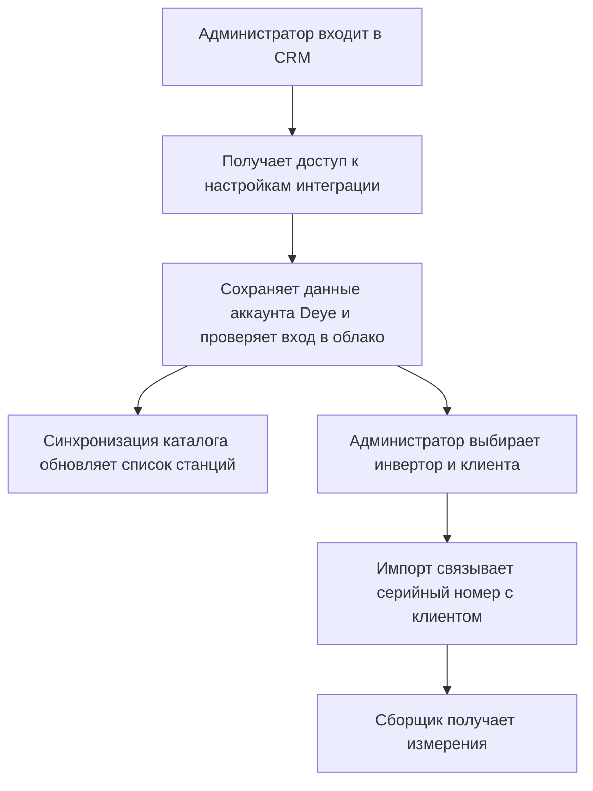
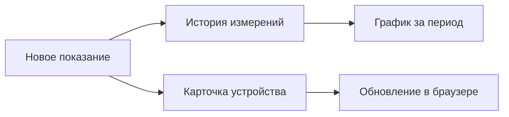
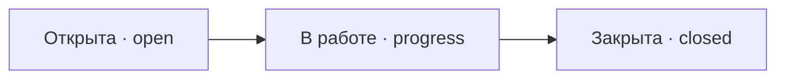

# Как работает Ата Энерго

Клиент хочет знать, работает ли его солнечная станция. Сотруднику нужны три ответа: чья это станция, когда от неё пришли последние данные и кто займётся проблемой. CRM связывает оборудование с клиентом, записывает измерения и даёт сотрудникам вести заявки. Посмотрим на путь одной станции от подключения до обслуживания.

## 1. Кто участвует

| Участник | Что делает |
|---|---|
| Клиент | Входит в личный кабинет, видит свои станции и оборудование, подаёт заявку и отслеживает свои обращения. Логин связывается с карточкой клиента. |
| Администратор | Управляет доступом и интеграциями. Под своей учётной записью CRM может настроить аккаунт Deye и проверить соединение. |
| Руководитель | По умолчанию может создавать, назначать, редактировать и удалять заявки и задачи. Управление аккаунтами через API Deye требует роли администратора. |
| Менеджер и техник | По умолчанию менеджер ведёт заявки и видит назначенные ему или созданные им задачи. Техник работает с назначенными ему карточками. |
| Диспетчер и наблюдатель | По умолчанию могут просматривать заявки. Права на заявки и задачи задаются в настройках ролей. |
| Локальный агент | Программа в сети клиента. Получает задания от сервера и передаёт результаты и показания. Для входа использует свой токен агента. |

## 2. Как подключают станцию

Сначала нужна карточка клиента. Дальше способ подключения зависит от того, где доступны измерения.

| Источник | Действие сотрудника | Что происходит дальше |
|---|---|---|
| Модем с MQTT | Регистрирует серийный номер модема у клиента. | Модем отправляет пакет в канал сообщений. Сервер узнаёт модем по номеру и распределяет показания по оборудованию. Пакет неизвестного модема пропускается. |
| Локальная сеть | Запускает агента на объекте, поручает поиск, проверяет найденное устройство и подключает его к клиенту. | Проверка подтверждает, что агент может прочитать показания. После подключения агент получает параметры опроса и регулярно передаёт данные серверу. |
| Deye Cloud | Настраивает аккаунт производителя, выбирает инвертор и импортирует его по серийному номеру для конкретного клиента. | CRM создаёт или обновляет запись модема. Сборщик опрашивает облако и приводит значения к общему формату мониторинга. |
| Демо-режим | Для демонстрации включает генерацию тестовых показаний. | Система имитирует работу подходящих модемов. Графики в этом режиме могут содержать сгенерированные значения. |

### Пример Deye — от входа в Swagger до первого измерения

1. **Войти в CRM.** В Swagger вызовите `POST /api/auth/login/` с логином и паролем администратора CRM. В **Authorize → BearerAuth** введите слово `Bearer`, пробел и значение поля `access`. Swagger сам подставляет имя заголовка `Authorization`.
2. **Настроить доступ к Deye.** Через `GET /api/deye/accounts/` получите локальный ID аккаунта. Для нового используйте `POST /api/deye/accounts/`, для существующего — `PATCH /api/deye/accounts/{id}/`. Для облака нужны App ID, App Secret, логин Deye и пароль Deye. Логином может служить email, имя пользователя или телефон с кодом страны. CRM шифрует данные в PostgreSQL. Для фонового опроса включите аккаунт и провайдера.
3. **Проверить вход в облако.** Вызовите `POST /api/deye/accounts/{id}/test/`. Список аккаунтов на предыдущем шаге читался из локальной базы. Только на этом шаге CRM проверяет вход в Deye.
4. **Найти и подключить инвертор.** `GET /api/deye/accounts/{id}/stations/?with_devices=1` показывает станции и оборудование облака. Через `POST /api/deye/accounts/{id}/import/` передайте серийный номер устройства и ID клиента. Номер станции позволяет связать модем с объектом в каталоге. Повторный импорт для того же клиента обновляет модем. Если номер уже закреплён за другим клиентом, CRM отклоняет импорт.
5. **Посмотреть результат.** Фоновая синхронизация каталога запускается при старте и затем каждые 15 минут. Она обновляет список станций и архивирует исчезнувшие из успешно полученного списка. Отдельный сборщик получает измерения импортированных инверторов с интервалом `DEYE_POLL_INTERVAL`. В карточке объекта текущие мощности и оборудование читаются непосредственно из Deye даже до назначения клиента. Импорт инвертора запускает накопление локальной истории оборудования, доступной в графиках CRM.

## 3. Как показание попадает на экран

Например, батарея сообщила заряд **64 %**. Сервер записывает измерение с временем в историю, обновляет последние данные батареи и отмечает её как доступную. Открытые экраны получают обновление через WebSocket. Карточка отвечает на вопрос «сколько сейчас», а график — «как менялось значение».

График выработки берёт внутри каждого интервала последнюю мощность каждой панели и складывает эти значения. Например, 300 Вт и 450 Вт дают точку 750 Вт. Единица точки — ватт. Если за интервал нет измерений мощности, на графике остаётся пропуск. При получении пакета модема с пропущенной секцией действует другое правило: для уже известного устройства сервер записывает нулевые показатели, а у батареи сохраняет последний известный процент заряда.

## 4. Как CRM замечает проблему

| Ситуация | Что увидит сотрудник |
|---|---|
| Инвертор прислал новый текст ошибки | Появится событие в ленте аварий. Пока текст ошибки повторяется подряд, обработчик показаний не создаёт новое событие на каждый пакет. |
| Напряжение сети упало с 230 В до 10 В | Переход с 50 В и выше на значение ниже 50 В создаёт событие отключения сети. |
| От работающего модема перестали поступать данные | После тайм-аута CRM переводит модем в `offline`. Для модема с оборудованием регистрируется одна авария потери связи. Для облачного подключения применяется отдельный тайм-аут. |
| Мощность оборудования ниже порога | В карточке может появиться состояние «низкая мощность». Для сравнения нужны номинал и числовое показание. При номинале 5 кВт и пороге 80 % граница равна 4 кВт. Для панелей и инверторов сравнение выполняется с 10:00 до 15:00 по времени Бишкека, исключая 15:00. |

Состояние в паспорте определяется по порядку: текущая ошибка устройства на связи, отметка об обслуживании, отсутствие связи, затем оценка мощности. Прочтение аварии меняет отметку в ленте. Чтобы понять, восстановилась ли станция, CRM смотрит на статус и последние показания.

## 5. Как от сигнала перейти к работе

**Пример.** Клиент заметил, что станция пропала из сети, и отправил обращение «Пропала связь». В кабинете появилась заявка со статусом «Открыта». Руководитель выбирает оборудование этого клиента, указывает срок и назначает техника. Техник берёт заявку в работу, проверяет связь на объекте и закрывает карточку после проверки новых показаний.

Это обычный путь заявки. Сотрудник с правом редактирования выбирает один из трёх статусов. Приоритет и срок ведутся отдельно. Для внутреннего поручения можно создать **задачу**. У заявок и задач общий формат карточки и отдельные права доступа. Журнал фиксирует автора, время, действие и снимок карточки, в том числе при удалении.

## Где искать причину, если данных не видно

| Что видно | Что проверить |
|---|---|
| Swagger вернул `401` на списке аккаунтов | Формат заголовка `Authorization: Bearer <access>` и срок действия токена CRM. При `403` после входа проверьте роль администратора. |
| Аккаунт виден, проверка Deye завершается ошибкой | Региональный адрес API, данные приложения и данные входа пользователя Deye. Запись в списке подтверждает сохранение аккаунта. |
| Список станций давно не менялся | Активность аккаунта и поставщика, время последней попытки, последнего успеха и ошибку в `provider_catalog_sync`. |
| Станция есть, показаний у клиента нет | Импорт нужного серийного номера, привязку модема к клиенту и аккаунту, состояние сборщика и время последнего сообщения модема. |

Назначение таблиц и связи между ними описаны в [справочнике PostgreSQL](DATABASE.md). Правила можно проследить в [обработке телеметрии](../services/telemetry.go), [интеграции Deye](../services/deye.go), [синхронизации каталога](../services/provider_catalog.go), [заявках и задачах](../handlers/api/crm.go) и [расчёте состояния оборудования](../handlers/api/crm_equipment.go).
