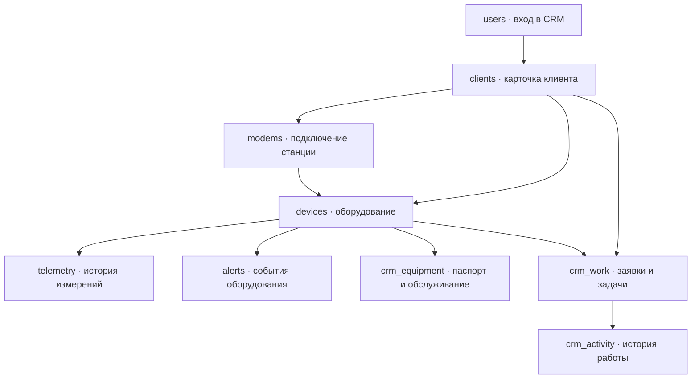
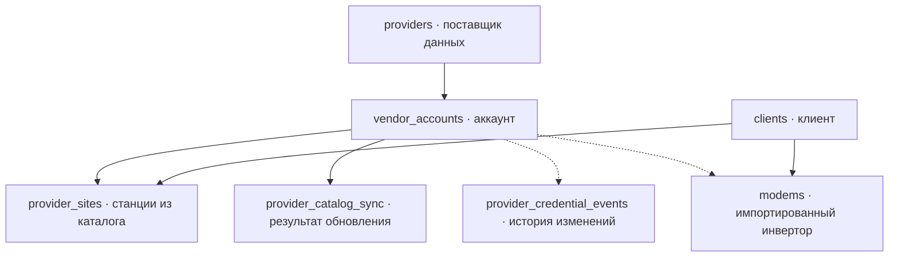

# Как устроена база данных Ата Энерго

Этот справочник описывает PostgreSQL после миграции 007. В схеме 19 таблиц приложения и одна служебная. Если вы знакомитесь с системой впервые, начните с примера работы станции. [Бизнес-логика CRM](BUSINESS_LOGIC.md)

## Как найти данные одной станции

Представим, что клиент звонит и спрашивает, какой заряд был у батареи утром. По карточке клиента в `clients` можно найти его модем в `modems`, а по модему — батарею в `devices`. Текущий заряд лежит в `devices.last_data`. Для ответа про утро нужны строки `telemetry` за нужное время.

На схеме стрелка ведёт от владельца или источника записи к связанным данным. У одного клиента может быть несколько модемов, а у каждого модема — несколько устройств.



## Кто входит в систему и чьё это оборудование

| Таблица | Что означает одна строка | Как используется |
|---|---|---|
| `users` | Пользователь CRM, сотрудник или клиент | Логин, хеш пароля CRM, роль, признак активности. На пользователя ссылаются авторы и исполнители работ. |
| `crm_roles` | Роль с уникальным кодом | `users.role` ссылается на `code`. Поле `grants` задаёт права на заявки и задачи. Когда оно пусто, приложение использует правила роли по умолчанию. |
| `clients` | Клиент, которому принадлежит оборудование | Имя, телефон и адрес. Необязательный уникальный `user_id` связывает карточку с логином личного кабинета. Можно завести клиента до выдачи доступа. |
| `modems` | Точка подключения оборудования одного клиента | `serial` уникален. `client_id` указывает владельца, `agent_id` — локального агента при его наличии. В `connection` лежат параметры подключения, в `sections` — состав разделов станции. При облачном подключении роль модема выполняет запись с серийным номером инвертора. |
| `devices` | Одно наблюдаемое устройство или часть станции, например батарея или ввод сети | Принадлежит клиенту, связь с модемом необязательна. Содержит тип, статус связи, время последнего сообщения и последние показания в `last_data`. |

**Два разных идентификатора.** Внутри `devices` поле `id` — числовой ключ PostgreSQL, а `device_id` — текстовый код устройства. Колонка `telemetry.device_id` ссылается на числовой `devices.id`. По тому же принципу с устройством связаны аварии и паспорт.

## Что происходит с оборудованием

| Таблица | Что означает одна строка | Как используется |
|---|---|---|
| `telemetry` | Измерение одного устройства в определённый момент | Источник истории и графиков. Строка может содержать мощность, напряжение, ток, заряд, температуру и ошибку. Набор доступных величин зависит от устройства. |
| `alerts` | Событие по устройству | Сохраняет вид события, текст и время. `is_read` — общая отметка о прочтении события. Текущее состояние оборудования определяется по связи и показаниям. |
| `crm_equipment` | Дополнительный паспорт одного устройства | По ключу `device_id` можно найти модель, номинальную мощность в ваттах, даты установки, гарантии и обслуживания, отметку о технических работах. Устройство может работать без заполненного паспорта. |
| `crm_settings` | Общая настройка CRM для оценки мощности | В таблице одна строка. `low_power_percent` задаёт порог в процентах от номинала. Начальное значение — 80. |

## Где лежат данные облака производителя



Сплошные линии здесь обозначают внешние ключи. Пунктир показывает две другие связи. История изменений сохраняет номер аккаунта даже после удаления, а у облачного модема номер аккаунта записан внутри JSON.

| Таблица | Что означает одна строка | Как используется |
|---|---|---|
| `providers` | Источник данных, например Deye | `code` определяет поставщика, `adapter` выбирает обработчик, `enabled` разрешает использование, `mock` помечает имитацию. Миграция регистрирует Deye, локальный мониторинг и демонстрационный Eybond. |
| `vendor_accounts` | Один аккаунт интеграции у поставщика | Видимые поля включают название, региональный адрес API и `is_active`. В `fields_encrypted` лежат App ID, App Secret, данные логина и хеш пароля Deye. `key_version` указывает версию ключа. После шифрования прежние открытые колонки пусты. |
| `provider_sites` | Одна станция из внешнего каталога | Станцию определяет сочетание поставщика, аккаунта (`credential_id`) и внешнего номера (`external_id`). Сохраняются название, адрес, координаты, статус и время синхронизации. Привязка к клиенту необязательна. |
| `provider_catalog_sync` | Последний результат обновления каталога одного аккаунта | `last_attempt_at` показывает время попытки, `last_success_at` — последнего успеха, `last_error` — результат последней ошибки. По этим полям можно понять, насколько свеж список станций. |
| `provider_credential_events` | Событие создания, изменения или удаления аккаунта | Триггер сохраняет действие, время, код поставщика, номер аккаунта и автора, если он известен. Запись истории сохраняется после удаления аккаунта. |

**Как связать станцию и инвертор Deye.** Для сопоставления CRM использует одновременно `modems.connection.account_id` и `modems.connection.station_id`. Первое значение соответствует `provider_sites.credential_id`, второе — `provider_sites.external_id`. Одна станция может объединять несколько инверторов. Если в каталоге остались станции аккаунта, внешний ключ ограничивает его удаление.

## Как оборудование находят в локальной сети

| Таблица | Что означает одна строка | Как используется |
|---|---|---|
| `agents` | Экземпляр программы в сети клиента | Хранит необязательную привязку к клиенту, сведения о компьютере, возможности и время последней связи. В базе лежат хеш токена агента и короткая подсказка. |
| `agent_tasks` | Машинное задание одному агенту | Например, поиск устройств или проверка конкретной находки. Содержит параметры, состояние выполнения, результат, журнал и сведения об инициаторе. |
| `found_devices` | Оборудование, замеченное при поиске | Адреса, модель, серийный номер, протоколы, результат проверки. Повторное обнаружение обновляет находку по агенту и ключу. После подключения `modem_id` ведёт к записи мониторинга. Для находок из браузера агент может отсутствовать. |

## Где сотрудники ведут работу

| Таблица | Что означает одна строка | Как используется |
|---|---|---|
| `crm_work` | Заявка (`requests`) или задача сотрудника (`tasks`) | Название, описание, статус, приоритет, срок, автор и исполнитель. Работу можно связать с клиентом и его оборудованием. |
| `crm_activity` | Изменение рабочей карточки | Действие, автор, время и снимок карточки в `snapshot`. После удаления карточки снимок доступен в журнале. |
| `schema_migrations` | Служебное состояние инструмента миграций | `version` показывает версию схемы, `dirty` отмечает незавершённую миграцию. Используется при обновлении приложения. |

## Пример запроса без доступа к секретам

Чтобы проверить наличие записи интеграции, достаточно выбрать её метаданные. Признак наличия зашифрованного блока сам по себе не подтверждает успешный вход в облако.

```sql
SELECT id, name, is_active,
       fields_encrypted IS NOT NULL AS has_encrypted_data,
       key_version
FROM vendor_accounts
WHERE vendor = 'deye'
ORDER BY id;
```

Определения таблиц и ограничений находятся в [миграциях PostgreSQL](../db/migrations). Упаковка и чтение учётных данных реализованы в [репозитории аккаунтов](../db/repositories/vendor_account.go).
